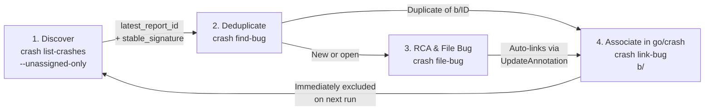

# Production Crash Triage & Remediation Playbook (`crash_triage.md`)

**Role:** Operational Playbook for `qemu-next` Production Crash Discovery,
Buganizer Triage, and `go/crash` Annotation Linking
**Location:** `hardware/google/aemu/tools/emu-dev-cli/docs/playbooks/`

## Overview

All Android Emulator binaries (`qemu-next`, classic `qemu2`, `fishtank`, `adb`,
and `netsimd`) upload crash minidumps to `go/crash` under the shared product
name `AndroidEmulator` (`crash.prod.latest`).

This playbook documents how `emu-dev-cli crash` isolates **`qemu-next`**
production crashes, filters out already-triaged signatures using both F1 SQL and
real-time `blade:crash-queryapi` RPCs, and closes the triage loop by linking
Buganizer issues back to `go/crash`.

---

## 1. How `qemu-next` Crashes Are Isolated in `crash.prod.latest`

Because `product_name = 'AndroidEmulator'` contains reports from multiple
binaries, `emu-dev-cli crash list-crashes` applies three filters in F1 SQL
(`/google/bin/releases/f1-team/public/f1-sql`):

1. **Exclude local developer/redacted builds:**
   ```sql
   NOT REGEXP_CONTAINS(c.product.Version, r'developer|redacted')
   ```
2. **Match `qemu-next` version numbering (`--version-regex`, default
   `r'0\.0\.1-|37'`):** Early `qemu-next` canary builds used `0.0.1-<build_id>`,
   while release-branch builds use `37.x.y-<build_id>` (e.g.,
   `37.1.3-16488488`). The suffix after `-` is the Android Build (`go/ab`)
   `build_id`.
3. **Exclude non-`qemu-next` loaded modules (`--exclude-modules`, default
   `r'Qt6|libandroid-emu|adb|netsimd'`):**
   ```sql
   AND (
     SELECT COUNT(*) > 1
       AND LOGICAL_AND(NOT REGEXP_CONTAINS(CodeFile, r'Qt6|libandroid-emu|adb|netsimd'))
     FROM UNNEST(c.Module)
   )
   ```
   - `adb` and `netsimd` crashes have `adb` / `netsimd` in `Module.CodeFile`.
   - Classic `qemu1` / `qemu2` / `fishtank` crashes link `Qt6*AndroidEmu` and
     `libandroid-emu-*` shared libraries (`.so`, `.dylib`, `.dll`).
   - `qemu-next` (both the launcher and `qemu-system-*` processes) does **not**
     link `Qt6` or `libandroid-emu`. Filtering by module exclusion rather than
     requiring `qemu-system` in `Module.CodeFile` preserves `qemu-next` launcher
     crashes (`1=LauncherLoop;` in `looper_registrations`) that occur before
     `qemu-system` is exec'd.

---

## 2. Dual-Source Bug Annotation Lookup (F1 Join + Live `blade:crash-queryapi`)

To determine whether a `stable_signature` already has a Buganizer issue attached
in `go/crash`, `emu-dev-cli crash list-crashes` combines two sources:

1. **F1 SQL Join (`crash_annotations.prod.latest`):**
   ```sql
   LEFT JOIN crash_annotations.prod.latest AS a
     ON a.Product = c.product_name
     AND a.SignatureType = 'Stable'
     AND a.StackSignature = c.stable_signature
   ```
   When `--unassigned-only` (`--untriaged`) is passed, the SQL `WHERE` clause
   includes `AND (a.BugInfo IS NULL OR ARRAY_LENGTH(a.BugInfo) = 0)` so F1 does
   not spend `LIMIT` slots on historically assigned signatures.
2. **Real-Time RPC Verification (`QueryAPIService.SearchAnnotations` on
   `blade:crash-queryapi`):** The `crash_annotations.prod.latest` F1 table
   refreshes **hourly**. During an active triage session (_query $\rightarrow$
   file bug $\rightarrow$ link bug $\rightarrow$ query next_), relying solely on
   F1 would cause a newly linked signature to keep appearing as unassigned for
   up to an hour. `list-crashes` therefore runs a batched
   `stubby call blade:crash-queryapi QueryAPIService.SearchAnnotations` for the
   returned `stable_signature`s and merges the live `BugInfo` links before
   applying `--unassigned-only`.

---

## 3. Closed-Loop Triage Workflow for Agents & Engineers

### A. Token-Efficient Daily Agent Workflow (`workflow triage-crashes`)

For daily autonomous triage, use the declarative state-machine workflow
`emu-dev-cli workflow triage-crashes`. It minimizes LLM token consumption by
performing all mechanical discovery, Buganizer signature deduplication, and
F1 stack-frame extraction during `init`, and emitting a single compact
Markdown **Triage Dossier** (`dossier-<state_id>.md`):

```bash
# 1. Initialize daily triage batch (default: --days 2 --limit 15)
emu-dev-cli workflow triage-crashes init -- --days 2

# 2. Inspect the generated Triage Dossier (< 150 lines total)
#    Contains top 8 symbolicated F1 stack frames, looper_registrations,
#    internal-msg, list_annotations, build_ids, and one-shot filing commands.

# 3. For each remaining cluster in the dossier:
#    - Write a concise RCA markdown file and file + auto-link directly
#      (without spawning a nested AI subprocess):
emu-dev-cli crash file-bug <latest_report_id> \
  --signature "<stable_signature>" \
  --title "[Crash][<OS>] <Subsystem>: <Symptom> (<stable_signature>)" \
  --from-rca /tmp/rca_<latest_report_id>.md
#    - Or link an existing/duplicate/WontFix Buganizer issue:
emu-dev-cli crash link-bug "<stable_signature>" b/<BUG_ID>

# 4. Advance and verify 100% of batch signatures have a BugUrl in go/crash
emu-dev-cli workflow triage-crashes next --id <state_id>
emu-dev-cli workflow triage-crashes next --id <state_id>
```

### B. Step-by-Step CLI Reference



### Step 1: Query Untriaged `qemu-next` Crashes (`crash list-crashes`)

```bash
# List all qemu-next crash clusters from the last 48 hours (default)
emu-dev-cli crash list-crashes

# List only untriaged (unassigned) crash clusters over the last 7 days
emu-dev-cli crash list-crashes --unassigned-only --days 7

# Machine-readable JSON output for automated agent loops
emu-dev-cli crash list-crashes --unassigned-only --days 7 --json
```

Each cluster returns:

- `stable_signature`: Canonical `go/crash` signature (e.g.
  `virtio_gpu_rutabaga_load-e709a6ba`).
- `occurrences`: Report count in the time window.
- `latest_report_id`: 16-hex Crash ID (`ReportID`) to pass to `find-bug`,
  `analyze`, or `file-bug`.
- `versions` and `build_ids`: Extracted `go/ab` build IDs (e.g. `16488488` from
  `37.1.3-16488488`).
- `crash_location`: Top faulting emulator stack frame
  (`FunctionName (SourceFileName:SourceLine)`), skipping `abseil-cpp` /
  `crash_reporter.cc` signal-handler frames.
- `stack_frames`: Top 8 symbolicated frames extracted directly from F1
  `CrashedStackTrace.StackFrame`.
- `custom_keys`: `internal-msg` (hang detector messages), `looper_registrations`
  (active threads/loops), and `list_annotations`.
- `bug_ids` / `bug_urls`: Linked Buganizer issues in `go/crash`.

### Step 2: Check Existing Bugs & Git History (`crash find-bug`)

Before running full AI RCA, check whether the crash is already tracked in
Buganizer Component `29601` or fixed in `HEAD` since the crash's `build_id`:

```bash
emu-dev-cli crash find-bug <latest_report_id>
```

- If `find-bug` discovers an existing duplicate Buganizer issue `b/<BUG_ID>`
  that simply wasn't linked in `go/crash` yet, jump straight to **Step 4**
  (`crash link-bug`).

### Step 3: Run RCA & File/Update Buganizer Issue (`crash file-bug`)

```bash
# Option A: Fast direct filing from an agent-authored RCA markdown file
# (bypasses nested AI subprocess and symbol archive download):
emu-dev-cli crash file-bug <latest_report_id> \
  --signature "<stable_signature>" \
  --title "[Crash][<OS>] <Subsystem>: <Symptom> (<stable_signature>)" \
  --from-rca /tmp/rca_<latest_report_id>.md

# Option B: Full standalone CrashAdvisor symbolication + nested AI RCA + filing:
emu-dev-cli crash file-bug <latest_report_id> \
  --title "[Crash][<OS>] <Subsystem>: <Symptom> (<stable_signature>)"
```

- Creates or updates the Buganizer issue in Component `29601` and
  **automatically links the Buganizer URL to the `stable_signature` in
  `go/crash`**.

#### Title Authoring Rules & Conventions

Issue titles must be descriptive, concise, and actionable:

- **Format:** `[Crash][<OS>] <Subsystem>: <Symptom> (<stable_signature>)`
- **Examples:**
  - `[Crash][Linux] Launcher: Failed to bind gRPC discovery port (FailWithoutStackTrace-7a37e8e9)`
  - `[Crash][macOS] Rutabaga: Out of bounds texture allocation (virtio_gpu_rutabaga_load-e709a6ba)`
  - `[Crash][Windows] Snapshot: Access violation during state deserialization (vmstate_load_state-8c29b1fa)`
- **Anti-Patterns (Prohibited):**
  - **Never** leave generic boilerplate abort/logging symbols as the title: e.g. `[Crash] absl::...::FailWithoutStackTrace-7a37e8e9`, `[Crash] __pthread_kill`, `[Crash] abort`. Always identify the first non-generic emulator domain frame.
  - **Never** leave template placeholders in the title: e.g. `<Subsystem>`, `<Symptom>`, `<OS>`.
  - Verification (`workflow triage-crashes next`) audits linked issue titles and will block completion if any issue has generic boilerplate or unresolved placeholders.

#### Updating an Existing Issue Title via CLI

If an issue was created with an uninformative title, update it directly via:

```bash
/google/bin/releases/issues-cli/issues mutate update title <issue_id> \
  "[Crash][<OS>] <Subsystem>: <Symptom> (<stable_signature>)"
```

### Step 4: Explicitly Link (or Unlink) a Bug in `go/crash` (`crash link-bug`)

When linking an existing bug (or a WontFix/noise tracking bug such as a broken
user SDK installation) to a crash signature so it no longer appears in
`--unassigned-only`:

```bash
# Link by stable_signature:
emu-dev-cli crash link-bug "absl::lts_20260526::synchronization_internal::PthreadWaiter::Wait-a030f826" b/567125517

# Or link by 16-hex crash ReportID (resolves stable_signature automatically):
emu-dev-cli crash link-bug 9dd7b05170400000 567125517

# Remove an erroneous bug link:
emu-dev-cli crash link-bug "virtio_gpu_rutabaga_load-e709a6ba" b/567125517 --unlink
```

### Step 5: Attempt Autonomous Remediation (`crash autofix`)

If the crash RCA indicates an actionable emulator bug that still exists at
`HEAD`:

```bash
emu-dev-cli crash autofix <latest_report_id>
```

---

## 4. Hotlist Organization & High-Volume Deduplication

To manage large numbers of crash reports for the same bug without thread spam or loss of signal:

### A. Crash Hotlists
All production `qemu-next` crash bugs in Component `29601` are automatically organized into two hotlists:
1. **General Hotlist:** `qemu-next-crashes` — tracks all production `qemu-next` crash issues.
2. **Version Hotlist:** `qemu-next-crashes-version-<version>` — tracks crashes discovered for a specific milestone release (e.g. `qemu-next-crashes-version-37.1.3`, stripping build suffixes).

### B. Duplicate Handling & Information-Gain Policy
When a new crash report arrives that matches an existing Buganizer issue:
- **`go/crash` as Occurrence Counter:** The `stable_signature` is linked to `b/<id>` in `go/crash`, which automatically tallies total occurrence counts, timeline distribution, and report links in `go/crash`.
- **Buganizer Noise Suppression:** If the crash has identical information (same crashing stack, same host OS, no novel error messages or breadcrumbs), duplicate Buganizer comments are skipped.
- **Novel Information Updates:** A concise update comment is added to Buganizer **only** when genuinely new diagnostics are found:
  1. **New Host OS Platform:** First reproduction on a different OS (e.g., first macOS occurrence for a Linux-only bug).
  2. **Potential Regression:** Crash reproduced on a bug already marked `FIXED` or `VERIFIED`.
  3. **Novel Breadcrumbs / Error Messages:** New `internal-msg`, distinct crash annotations, or new assertions.
  4. **Divergent Fault Location:** Top faulting emulator function differs from previously recorded frames.


